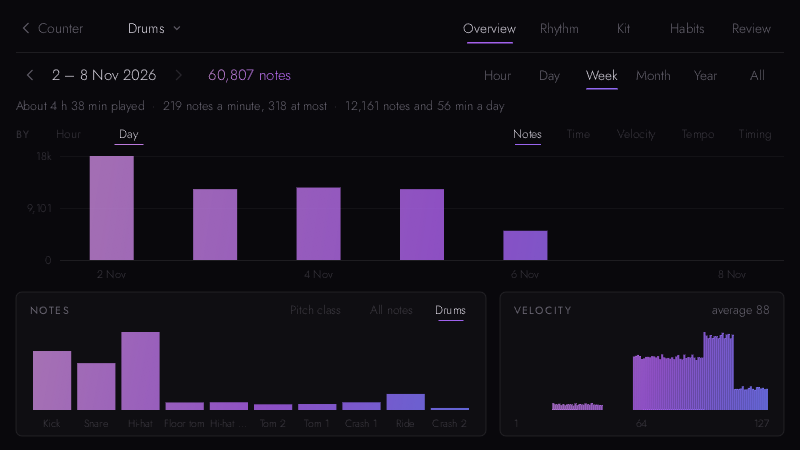
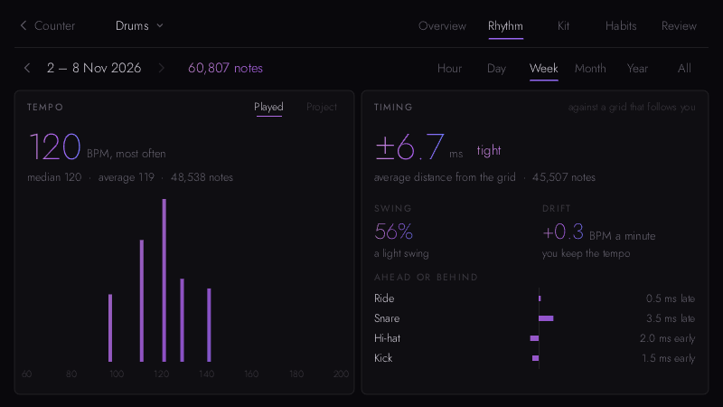
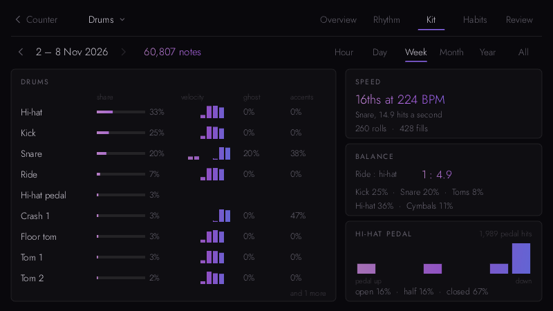
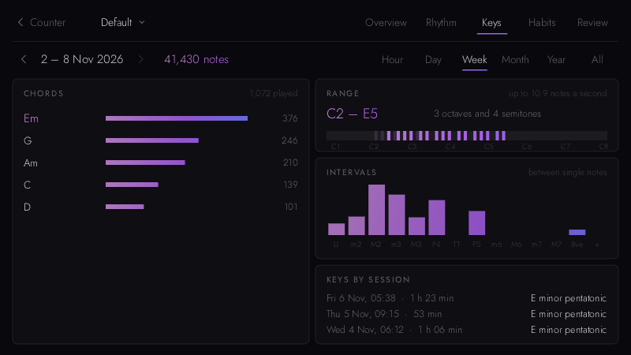
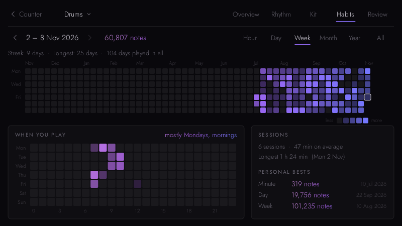
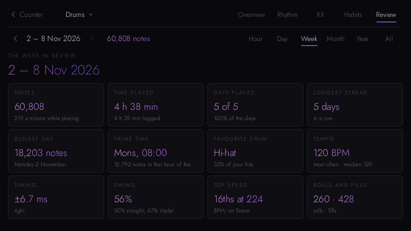

A VST3 plugin for Linux, by Kaia, that counts every note you play, forever.


- Counts every MIDI note-on, per **profile** ("Drums" in one instance, "Keys" in another).
- **Audio profiles** count time instead: for an instrument that sends audio (bass, guitar, vocals),
  the counter is a clock of the time you've played, going up by the second while a signal comes in
  and stopping after 4 seconds of silence (see "Audio profiles" below).
- **One hit, one count**: e-drum pads often send a burst of notes for one strike (double triggers).
  A retrigger guard counts repeats of the same drum within 30 ms once (adjustable per profile).
- **Drum map**: name your pads ("Snare", "Crash 2", anything) with **Learn**, per profile, and see
  hits per drum in the stats.
- Changes nothing: audio passes through bit for bit, and MIDI goes on to the next plugin untouched.
- **Stats**: notes per minute, hour, day, week, month or year over any hour, day, week, month or year
  (or all time); which notes you play most (by pitch class or by note, with General MIDI drum names),
  your likely scale, and how hard you play (velocity).
- **Time played**: how long you played in any range, notes a minute (average and busiest minute),
  and the average per hour, day, week, month or year. A minute with only a few notes (the start or
  end of a session) counts as part of a minute, measured against your usual pace (see "How time
  played is worked out" below). The timeline shows notes, time, average velocity, tempo or timing.
- **Rhythm, no click needed**: the tempo you play at, worked out from your notes (and the project's
  tempo while Reaper's transport plays), with the most common, median and average. **Timing**: how
  far your notes land from an imagined grid that follows your own tempo, which drums sit ahead or
  behind, your swing, and whether you speed up or slow down.
- **Kit**: per drum, share of hits, a velocity histogram, ghost notes and accents, and drums you
  hardly play; top speed, rolls and fills; ride vs hi-hat; how open you play the hi-hat (if you turn
  on the hi-hat pedal). **Keys** profiles get chords, intervals, your range and the key of each
  session instead.
- **Habits**: your streak, a calendar of the year, when in the week you play, sessions, and
  personal bests. **Review**: the highlights of any range, a "year in review" for a year.
- The counter screen shows your streak, and celebrates milestones (1,000 notes, 10,000, ...,
  1,000,000 ...), your best day and your busiest minute.
- The window can be resized to any size and shape: drag the edge of the plugin window and the layout
  scales and stretches to fill it. Each instance remembers its size.
- Very light: the audio thread only pushes a few bytes per note into a lock-free queue. The window
  draws only when something changes. Saves happen every 30 seconds, and only if you played.





## Counting only what you play (Reaper)

The plugin can't tell a note you played from a note played back from a MIDI item. To count only
your playing, put it in the track's **Input FX**, not the normal FX chain:

1. Open the track's **Input FX** chain: in the mixer, click **IN FX** above the track's FX slots
   (right-clicking the FX button on the track panel also offers it).
2. Add **Modometer (Kaia)**.
3. Record-arm the track with record monitoring on, as you would to play live.

Input FX only see the live input, so playback is never counted. Put your instrument in the normal FX
chain as usual. Each instance has its own profile, saved with the project.

## Audio profiles: time played

When you create a profile (profile menu, **New profile…**), pick **MIDI · notes** (the usual note
counter) or **Audio · time**. An audio profile ignores MIDI and listens to the audio coming through
the plugin instead:

- Playing is a signal louder than -50 dBFS. While it comes in, the counter (hours:minutes:seconds)
  goes up by the second and shows **playing**.
- Short pauses keep the clock running. After 4 seconds of silence it stops, until you play again.
  Those 4 seconds count as playing (the clock showed them).
- The stats show the time played on the timeline and in the habits (calendar, when you play,
  sessions, best day and week). The note pages (rhythm, keys, review) don't apply.
- Put it in the track's Input FX like the MIDI counter, so only your live input is timed. The audio
  still passes through untouched.

To change the threshold, edit `audio-threshold-db -50` in the profile's `settings.txt` (a noisy
pickup may need -40). A profile's type is set when it's created; MIDI profiles work as before.

## Drums: names, Learn and the retrigger guard


Click **Drums** on the counter screen.

- **Learn**: press it, hit a pad, then type a name or pick one (Kick, Snare, Crash 2, …) and Save.
  You can also click any line under **Recent hits** to name that note, or a named drum to rename or
  remove it. Give several notes the same name (say the snare's head and rim) to count them as one
  drum. Names belong to the profile.
- **Recent hits** shows every note-on that arrives: note, name, velocity, and the time since the
  same drum's last note. Hits the guard dropped show as *ignored*. If one strike of a pad shows
  several lines, that's what your module is sending.
- **Retrigger guard**: hits of the same drum closer together than this count once. 30 ms by default
  (Off, 10–150 ms). Real strokes on one drum are rarely closer than 40–50 ms; e-drum double triggers
  usually come within 5–20 ms.

The stats view's notes panel has a **Drums** tab with hits per named drum (unnamed notes as Other).

- **Hi-hat pedal**: turn it on to read the pedal's position (MIDI CC 4) with every hi-hat hit, for
  the Kit page's "how open" chart. It maps CC 4 to the plugin's "Hi-hat pedal" parameter. It's off
  by default: check that your hi-hat still sounds right in Reaper with it on (the CC should still
  reach your drum plugin).

Naming your drums also tells Modometer the profile is a drum kit, which turns on the drum analysis
(rolls, fills, per-drum dynamics and timing). Names like "Kick", "Snare", "Tom 1", "Hi-hat", "Ride"
say what each drum is; unnamed notes count by their General MIDI meaning.

## The stats pages

- **Overview**: the timeline, notes and velocity.
- **Rhythm**: tempo and timing (below).
- **Kit** (drum profiles) or **Keys** (others).

  

  
- **Habits**: streaks, the calendar (click a day to see it), when you play, sessions, personal bests.

  
- **Review**: the range at a glance. Pick **Year** for your year in review.

  

### How tempo and timing are worked out

You don't need a click or the DAW's tempo. Every couple of seconds Modometer looks at the notes
you just played (a few seconds either side of each): the gaps between them vote for the beat, with
kick and snare counting most and hi-hats least, and tempos around 115 BPM preferred, so a groove
with eighth-note hi-hats isn't taken for double time. Like any beat tracker it can't always tell
a tempo from its half or double: very slow or very fast playing (below about 80 or above 160 BPM)
may show at half or twice the tempo you'd count.

Then it fits a grid of sixteenths (or triplets) to your notes, following your tempo and phase as
you play. **Timing** is how far each note lands from the nearest grid line: steadiness, not whether
you kept a tempo you never set. As a rough guide, under 6 ms is very tight, under 11 ms tight. Grace
notes, flams and 32nds are left out, and so is free-time playing (no steady rhythm, no tempo).
Per drum, the offsets show which drums you play ahead of or behind the others (a laid-back snare,
say). **Swing** is where the off-beat lands in the beat: 50 % straight, 67 % triplet swing. **Drift**
is how much the tempo rose or fell over a minute of steady playing.

The **project tempo** (Played / Project on the Rhythm page) is Reaper's tempo, logged only while
the transport plays.

### How time played is worked out

The logs keep one line per minute you played in, so the minutes logged are an upper bound: a
minute where you hit two notes and stopped counts as a whole one. So Modometer also estimates. It
learns your pace from the last 90 days: the minutes in the middle of a session (with played minutes
on both sides) show what steady playing looks like, and half their median is a "full minute". A
minute with that many notes or more counts as a whole minute; one with fewer counts in proportion
(a quarter of the notes, a quarter of a minute). With less than ten mid-session minutes to go on,
every logged minute counts in full. Hover over "About … played" to see the logged time and the
pace. Very slow, sparse playing will read a little low.

## Building and installing

Every push is built and tested by GitHub Actions. To get a build without compiling: open the
repository's **Actions** tab, pick the latest **Build** run, and download the
`Modometer-vst3-linux-…` artifact at the bottom. Unzip it and copy `Modometer.vst3` into
`~/.vst3` (delete an older `Modometer.vst3`, or `MIDI-Counter.vst3` from before the rename, there, if any). It needs glibc 2.35 or newer (Ubuntu 22.04 and later, and most current distros).

To build it yourself you need Rust (stable); X11 and OpenGL are loaded at run time.

```bash
./scripts/bundle.sh --install
```

This builds `target/bundle/Modometer.vst3` and copies it to `~/.vst3`, replacing an older
build (and removing `MIDI-Counter.vst3` from before the rename). Rescan plugins in Reaper.

## Your data

Counts are saved in `~/.local/share/modometer/profiles/<profile>/` (or under `$XDG_DATA_HOME`).
`.local` is a hidden folder: press Ctrl+H in your file manager to see it. To keep the data in a
synced folder, move that `modometer` folder there and symlink it back.

Each profile's folder holds its month logs, `totals.cache`, and `settings.txt` (drum names and the
retrigger guard):

```
retrigger-ms 30
note 36 Kick
note 38 Snare
```

The plugin rewrites `settings.txt` when you change something in the Drums view, and picks up edits
made by hand within 30 seconds.

Each month is one small text file you can read or back up, one line per minute you played:

```
2026-11-05T15:04Z 212 n36:40,38:22,42:150 v64:12,100:200
```

That's the UTC minute, the number of notes, then how often each note (`n`) and each velocity (`v`)
came up. More fields follow with the analysis (tempo, timing, ...), listed in
[docs/Requirements.md](docs/Requirements.md). Files are only ever appended to.

An audio profile's lines hold seconds of playing instead of notes (`2026-11-05T15:04Z 42`), and its
`settings.txt` starts with `type audio`.

When a month is over (from the month after next), Modometer compacts it: one line per minute,
gzipped, as `2026-09.log.gz`. Read it with `zcat` or `zless`. That keeps a year of playing to a few
MB and one file per month. Older versions of the plugin don't read compacted months.

## Development

```bash
cargo test
```

```bash
cargo run --example preview
```

`preview` opens the window on its own with made-up data (`--stats` or `--kit` to start on the stats
or drums view, `--page rhythm|kit|habits|review` for a stats page, `--chart velocity|tempo|timing`
for the timeline, `--profile Drums` for the drum kit, `--profile Bass` for an audio profile,
`--size 1200x500` for another window size, `--screenshot file.png` to save a frame and exit). `embed_test` (`-- 6 --resize` to test resizing) embeds the editor into a parent
window through the VST3 view interface, as a host does.

## License

MIT. The Jost font is under the SIL Open Font License (`resources/fonts/OFL.txt`).
