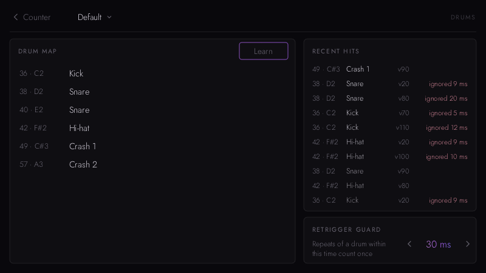

# MIDI Counter

A VST3 plugin for Linux, by Kaia, that counts every note you play, forever.


- Counts every MIDI note-on, per **profile** ("Drums" in one instance, "Keys" in another).
- **One hit, one count**: e-drum pads often send a burst of notes for one strike (double triggers).
  A retrigger guard counts repeats of the same drum within 30 ms once (adjustable per profile).
- **Drum map**: name your pads ("Snare", "Crash 2", anything) with **Learn**, per profile, and see
  hits per drum in the stats.
- Changes nothing: audio passes through bit for bit, and MIDI goes on to the next plugin untouched.
- **Stats**: notes per minute, hour, day, week, month or year over any hour, day, week, month or year
  (or all time); which notes you play most (by pitch class or by note, with General MIDI drum names),
  your likely scale, and how hard you play (velocity).
- The window can be resized: drag the edge of the plugin window and everything scales, keeping its
  shape. Each instance remembers its size.
- Very light: the audio thread only pushes a few bytes per note into a lock-free queue. The window
  draws only when something changes. Saves happen every 30 seconds, and only if you played.


## Counting only what you play (Reaper)

The plugin can't tell a note you played from a note played back from a MIDI item. To count only
your playing, put it in the track's **Input FX**, not the normal FX chain:

1. Open the track's **Input FX** chain: in the mixer, click **IN FX** above the track's FX slots
   (right-clicking the FX button on the track panel also offers it).
2. Add **MIDI Counter (Kaia)**.
3. Record-arm the track with record monitoring on, as you would to play live.

Input FX only see the live input, so playback is never counted. Put your instrument in the normal FX
chain as usual. Each instance has its own profile, saved with the project.

## Drums: names, Learn and the retrigger guard



Click **Drums** on the counter screen.

- **Learn**: press it, hit a pad, then type a name or pick one (Kick, Snare, Crash 2, …) and Save.
  You can also click any line under **Recent hits** to name that note, or a named drum to rename or
  remove it. Give several notes the same name (say the snare's head and rim) to count them as one
  drum. Names belong to the profile.
- **Recent hits** shows every note-on that arrives: note, name, velocity, and the time since the
  same drum's last note. Hits the guard dropped show as *ignored*. If one strike of a pad shows
  several lines, that's what your module is sending.
- **Retrigger guard**: hits of the same drum closer together than this count once. 30 ms by default
  (Off, 10–150 ms). Real strokes on one drum are rarely closer than 40–50 ms; e-drum double triggers
  usually come within 5–20 ms.

The stats view's notes panel has a **Drums** tab with hits per named drum (unnamed notes as Other).

## Building and installing

Every push is built and tested by GitHub Actions. To get a build without compiling: open the
repository's **Actions** tab, pick the latest **Build** run, and download the
`MIDI-Counter-vst3-linux-…` artifact at the bottom. Unzip it and copy `MIDI Counter.vst3` into
`~/.vst3`. It needs glibc 2.35 or newer (Ubuntu 22.04 and later, and most current distros).

To build it yourself you need Rust (stable); X11 and OpenGL are loaded at run time.

```bash
./scripts/bundle.sh --install
```

This builds `target/bundle/MIDI Counter.vst3` and copies it to `~/.vst3`. Rescan plugins in Reaper.

## Your data

Counts are saved in `~/.local/share/midi-counter/profiles/<profile>/` (or under `$XDG_DATA_HOME`).
`.local` is a hidden folder: press Ctrl+H in your file manager to see it. To keep the data in a
synced folder, move that `midi-counter` folder there and symlink it back.

Each profile's folder holds its month logs, `totals.cache`, and `settings.txt` (drum names and the
retrigger guard):

```
retrigger-ms 30
note 36 Kick
note 38 Snare
```

The plugin rewrites `settings.txt` when you change something in the Drums view, and picks up edits
made by hand within 30 seconds.

Each month is one small text file you can read or back up, one line per minute you played:

```
2026-11-05T15:04Z 212 n36:40,38:22,42:150 v64:12,100:200
```

That's the UTC minute, the number of notes, then how often each note (`n`) and each velocity (`v`)
came up. Files are only ever appended to. See [docs/Requirements.md](docs/Requirements.md) for why.

## Development

```bash
cargo test
```

```bash
cargo run --example preview
```

`preview` opens the window on its own with made-up data (`--stats` or `--kit` to start on the stats
or drums view, `--screenshot file.png` to save a frame and exit). `embed_test` (`-- 6 --resize` to test resizing) embeds the editor into a parent
window through the VST3 view interface, as a host does.

## License

MIT. The Jost font is under the SIL Open Font License (`resources/fonts/OFL.txt`).
