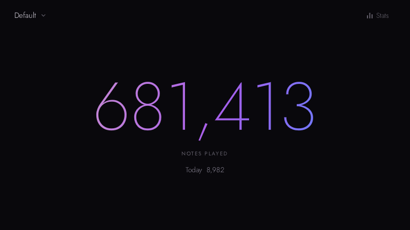

# MIDI Counter

A VST3 plugin for Linux, by Kaia, that counts every note you play, forever.



- Counts every MIDI note-on, per **profile** ("Drums" in one instance, "Keys" in another).
- Changes nothing: audio passes through bit for bit, and MIDI goes on to the next plugin untouched.
- **Stats**: notes per minute, hour, day, week, month or year over any hour, day, week, month or year
  (or all time); which notes you play most (by pitch class or by note, with General MIDI drum names),
  your likely scale, and how hard you play (velocity).
- Very light: the audio thread only pushes a few bytes per note into a lock-free queue. The window
  draws only when something changes. Saves happen every 30 seconds, and only if you played.


## Counting only what you play (Reaper)

The plugin can't tell a note you played from a note played back from a MIDI item. To count only
your playing, put it in the track's **Input FX**, not the normal FX chain:

1. Open the track's **Input FX** chain: in the mixer, click **IN FX** above the track's FX slots
   (right-clicking the FX button on the track panel also offers it).
2. Add **MIDI Counter (Kaia)**.
3. Record-arm the track with record monitoring on, as you would to play live.

Input FX only see the live input, so playback is never counted. Put your instrument in the normal FX
chain as usual. Each instance has its own profile, saved with the project.

## Building and installing

You need Rust (stable) and the X11/OpenGL development basics your distribution ships.

```bash
./scripts/bundle.sh --install
```

This builds `target/bundle/MIDI Counter.vst3` and copies it to `~/.vst3`. Rescan plugins in Reaper.

## Your data

Counts are saved in `~/.local/share/midi-counter/profiles/<profile>/` (or under `$XDG_DATA_HOME`).
To keep them in a synced folder, move that `midi-counter` folder there and symlink it back.

Each month is one small text file you can read or back up, one line per minute you played:

```
2026-11-05T15:04Z 212 n36:40,38:22,42:150 v64:12,100:200
```

That's the UTC minute, the number of notes, then how often each note (`n`) and each velocity (`v`)
came up. Files are only ever appended to. See [docs/Requirements.md](docs/Requirements.md) for why.

## Development

```bash
cargo test
```

```bash
cargo run --example preview
```

`preview` opens the window on its own with made-up data (`--stats` to start on the stats view,
`--screenshot file.png` to save a frame and exit). `embed_test` embeds the editor into a parent
window through the VST3 view interface, as a host does.

## License

MIT. The Jost font is under the SIL Open Font License (`resources/fonts/OFL.txt`).
